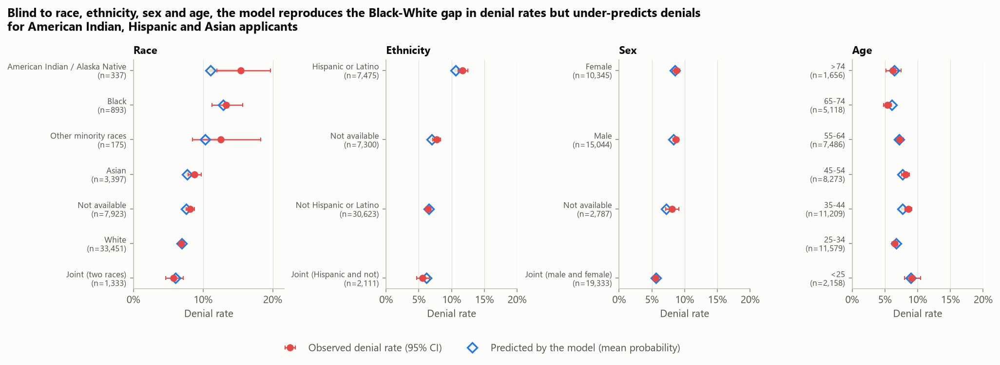
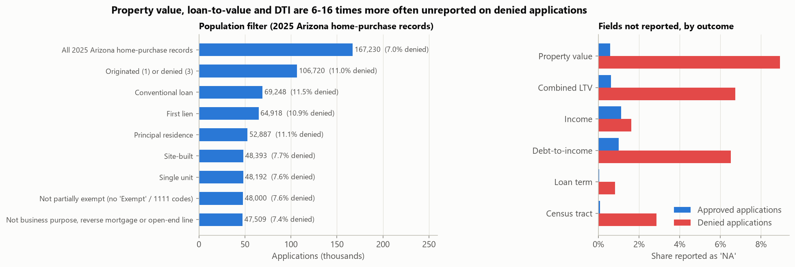
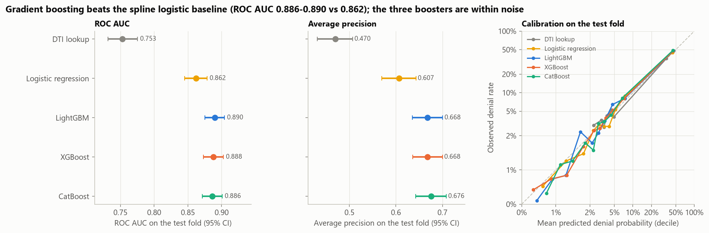
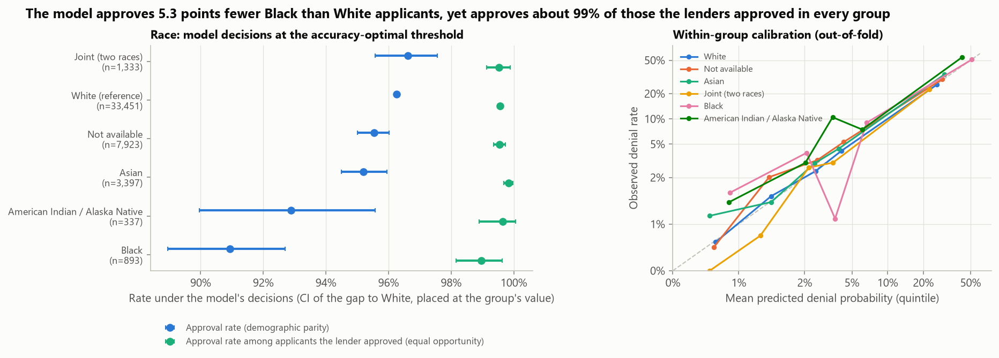
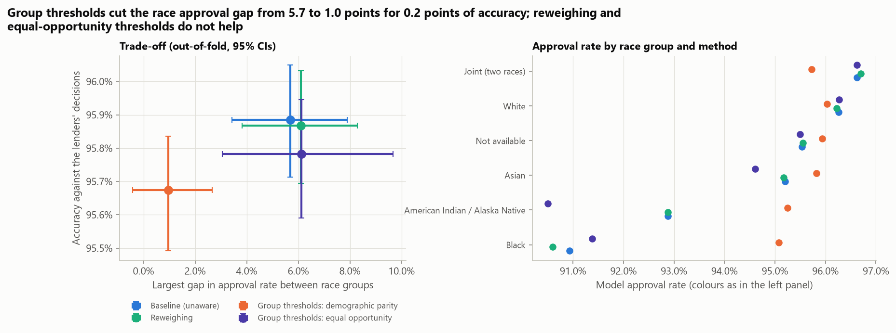
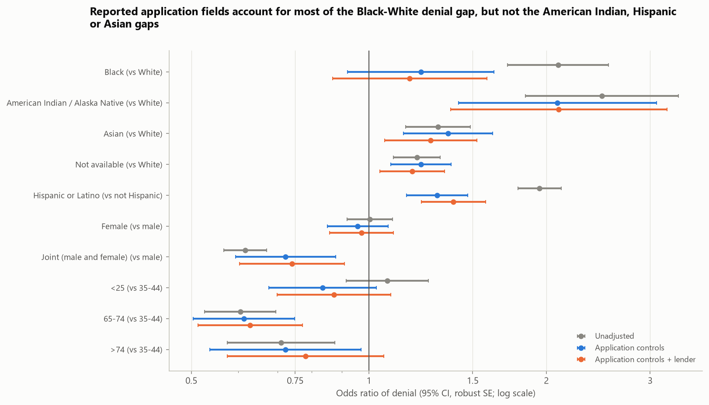
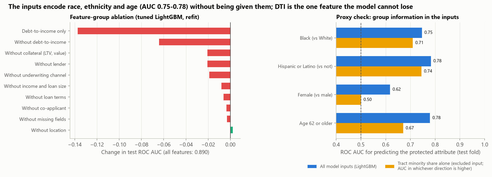
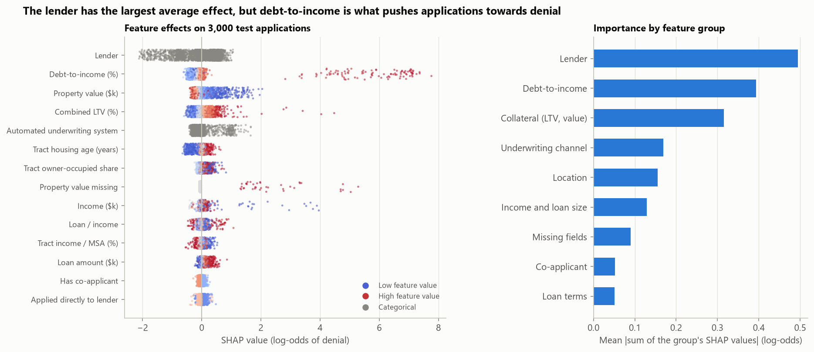
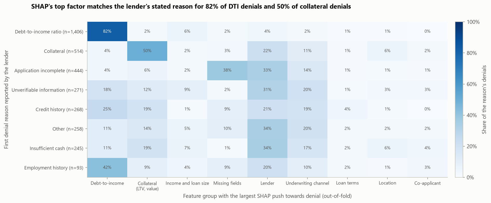
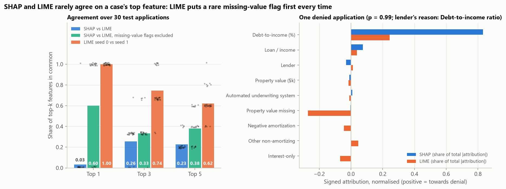

# Explainable and Fair Credit Decisions on HMDA Mortgage Data

[](https://github.com/ChetanYarlagadda/mortgage-fairness-explainability/actions/workflows/ci.yml)

**How well can mortgage denials be predicted without protected attributes, what drives the predictions, and does
the resulting model treat groups of applicants differently?** This project trains denial models on 47,509
conventional home-purchase applications from Arizona's 2025 public HMDA data, explains them with SHAP and LIME,
audits them by race, ethnicity, sex and age with fairlearn, and measures what it costs to close the gaps.

It mirrors the work of a credit-risk model team and its model-risk or fair-lending reviewers: a gradient-boosted
decision model tuned with Optuna, explanations that have to hold up as adverse-action reasons, and a fairness review
that must separate what the model does from what the historical decisions it learned from already contained.

> **This is observational data.** HMDA has no credit scores, assets, employment details or full credit histories,
> and race, ethnicity and sex are reported by the applicants (or recorded by visual observation for some
> in-person applications). The gaps reported below are associations. This analysis cannot attribute them to
> discrimination, and it cannot rule discrimination out either.



## Key findings

Models are compared on an untouched test fold (9,502 applications, 701 denied). The fairness results use
out-of-fold predictions for all 47,509 applications (five rotations, each application scored by a model that never
saw it). Brackets are 95% bootstrap CIs.

| Model (test fold) | ROC AUC | Average precision | Brier | ECE | Flagged at threshold | Denial precision / recall |
|---|---:|---:|---:|---:|---:|---:|
| DTI lookup (baseline) | 0.753 [0.732, 0.775] | 0.470 | 0.0465 | 0.0065 | 4.7% | 68% / 43% |
| Logistic regression (splines) | 0.862 [0.845, 0.878] | 0.607 | 0.0410 | 0.0052 | 4.2% | 82% / 46% |
| **LightGBM** (Optuna, 30 trials) | **0.890** [0.875, 0.904] | 0.668 | 0.0372 | 0.0065 | 4.0% | 89% / 48% |
| XGBoost (Optuna, 20 trials) | 0.888 [0.873, 0.902] | 0.668 | 0.0371 | 0.0048 | 4.2% | 87% / 50% |
| CatBoost (Optuna, 10 trials) | 0.886 [0.871, 0.901] | **0.676** | **0.0369** | 0.0072 | 4.1% | 88% / 49% |

<sub>Threshold: the accuracy-maximising cut-off chosen on the validation fold. Full table in
[`model_results.csv`](reports/results/model_results.csv); paired tests in
[`model_significance.csv`](reports/results/model_significance.csv).</sub>

1. **The download reproduces the official aggregates exactly.** All 34 record counts and loan-amount sums (by
   action, loan type, lien, construction method, derived race, ethnicity and sex) match the Data Browser's own
   aggregation API. The analysed population is 47,509 applications from 554 lenders, 7.4% denied.
2. **Gradient boosting beats a spline logistic regression, and the three boosters tie.** LightGBM reaches ROC AUC
   0.890 against 0.862 (+0.028 [0.017, 0.038], Holm p = 0.018) and AP 0.668 against 0.607; XGBoost and CatBoost
   differ from LightGBM by at most 0.004 AUC and 0.008 AP (Holm p >= 0.59). Debt-to-income alone gives 0.753. All
   models are calibrated (ECE <= 0.007).
3. **A model that never sees race reproduces the Black-White gap in denial rates, but not every gap.** Within
   groups, predicted and observed denial rates agree for White (6.9% vs 6.8%) and Black applicants (12.9% vs 13.3%),
   but the model under-predicts denials for American Indian / Alaska Native (11.1% vs 15.4%, gap +4.4 points
   [1.6, 7.4]), Hispanic or Latino (10.6% vs 11.7%, +1.1 [0.5, 1.6]) and Asian applicants (7.7% vs 8.8%, +1.1
   [0.5, 1.7]); all three survive Holm correction over 22 groups. Adjusted odds ratios agree: controlling for the
   reported application fields moves the Black-White denial odds ratio from 2.09 to 1.22 [0.92, 1.63], while the
   American Indian (2.48 -> 2.09), Hispanic (1.95 -> 1.31) and Asian (1.31 -> 1.36) odds ratios stay above 1.
4. **Leaving protected attributes out does not make the model blind to them, and the fairness criteria conflict.**
   The model's inputs predict Black vs White applicants with AUC 0.75, Hispanic vs not with 0.78 and age 62+ with
   0.78. At the decision threshold the model approves 90.9% of Black and 96.3% of White applicants (demographic
   parity gap 5.3 points [3.6, 7.3]), yet approves 99.0% and 99.6% of the applicants the lenders approved (equal
   opportunity gap 0.6 points, CI includes zero). With different base rates and a calibrated score, the two criteria cannot both hold.
5. **Closing the approval gap is cheap in accuracy but needs race at decision time.** Group-specific thresholds
   (fairlearn ThresholdOptimizer, demographic parity) cut the largest race approval gap from 5.7 to 1.0 points for
   0.2 points of accuracy (95.9% -> 95.7%; denial precision 90.1% -> 87.7%), while the equal opportunity gap widens
   from 0.9 to 1.7 points. Reweighing does not narrow the gap (6.1 points), and equal-opportunity thresholds make both gaps
   worse out of fold. Using race in credit decisions is generally not allowed under US fair-lending law, so this
   only sizes the trade-off.
6. **SHAP matches the lenders' stated reasons where HMDA can see them; LIME disagrees with SHAP for a mechanical
   reason.** For 82% of the 1,406 denials whose first reported reason is debt-to-income, DTI carries SHAP's largest
   push towards denial (12% for denials with other reasons); for collateral denials the collateral features do so
   in 50% (8% otherwise). LIME agrees with itself on the top feature in 30 of 30 cases but with SHAP in only 1:
   it ranks "property value reported" first every time. Without the missing-value flags, SHAP and LIME share the
   top feature in 18 of 30 cases.

## Results

### Data and the official cross-check



The Data Browser API accepts at most two filter criteria per query, so the pipeline downloads every 2025 Arizona
home-purchase record (167,230 rows; the API redirects to a static snapshot file, Last-Modified 21 July 2026) and
filters locally. It then queries the same API for its aggregations by seven dimensions; all 34 category counts and
loan-amount sums equal the ones recomputed from the file
([`api_crosscheck.csv`](reports/results/api_crosscheck.csv)).

| Filter step ([`population_filter.csv`](reports/results/population_filter.csv)) | Applications | Denied |
|---|---:|---:|
| All 2025 Arizona home-purchase records | 167,230 | 7.0% |
| Originated (1) or denied (3) | 106,720 | 11.0% |
| Conventional, first lien, principal residence | 52,887 | 11.1% |
| Site-built, single unit | 48,192 | 7.6% |
| Not partially exempt ('Exempt' / code 1111) | 48,000 | 7.6% |
| Not business purpose, reverse mortgage or open-end line | **47,509** | **7.4%** |

'NA' codes are kept as missing values with explicit flags, and they are not innocent: property value is unreported
on 8.9% of denials and 0.6% of approvals, combined LTV on 6.7% vs 0.6%, DTI on 6.5% vs 1.0%
([`missingness_by_outcome.csv`](reports/results/missingness_by_outcome.csv)); lenders do not always compute them
for applications denied early, for example as incomplete. Fields that exist only after a decision (pricing,
purchaser, HOEPA status, denial reasons) or that encode the outcome by construction (pre-approval: denied
pre-approval requests are action 7, outside this population; "initially payable" code 3 occurs only for denials)
are excluded, as are the protected attributes and the census-tract minority share
([`excluded_fields.csv`](reports/results/excluded_fields.csv)).

### Models



All models use the same 29 inputs: loan amount, property value, combined LTV, income, loan-to-income, DTI, loan term
and product features (intro-rate period, interest-only, balloon, negative amortisation, jumbo), census-tract income,
housing age and owner-occupancy, MSA income, whether the applicant applied directly and has a co-applicant, six
missing-value flags, and four categoricals: lender (40 largest plus "other"), county, automated underwriting system
and credit-score model (which scoring model was used, not the score). Optuna tuned each booster on validation log
loss; the best trials ([`tuned_models.csv`](reports/results/tuned_models.csv)) used 310 (LightGBM), 304 (XGBoost)
and 479 (CatBoost) boosting rounds. Logistic regression chose C = 10, the largest value in its grid.

### Fairness audit



Every metric is computed on out-of-fold predictions for all 47,509 applications (out-of-fold ROC AUC 0.879; per
rotation 0.869-0.890, [`crossfit_rotations.csv`](reports/results/crossfit_rotations.csv)). Within-group ROC AUC is
0.86-0.92 in every group with at least 150 applications ([`fairness_audit.csv`](reports/results/fairness_audit.csv)).

| Group (reference) | n | Observed denial | Predicted denial | Calibration gap (Holm p) | Model approval rate (gap) | True approval rate (gap) |
|---|---:|---:|---:|---:|---:|---:|
| White (ref.) | 33,451 | 6.8% | 6.9% | -0.1 (1.00) | 96.3% | 99.6% |
| Black | 893 | 13.3% | 12.9% | +0.4 (1.00) | 90.9% (-5.3 [-7.3, -3.6]) | 99.0% (-0.6 [-1.4, +0.1]) |
| American Indian / Alaska Native | 337 | 15.4% | 11.1% | **+4.4** (0.022) | 92.9% (-3.4 [-6.3, -0.7]) | 99.6% (+0.1 [-0.7, +0.5]) |
| Asian | 3,397 | 8.8% | 7.7% | **+1.1** (0.022) | 95.2% (-1.1 [-1.8, -0.3]) | 99.8% (+0.3 [+0.1, +0.4]) |
| Race not available | 7,923 | 8.1% | 7.6% | +0.6 (0.064) | 95.5% (-0.7 [-1.3, -0.2]) | 99.6% (-0.0 [-0.2, +0.2]) |
| Hispanic or Latino (vs not Hispanic) | 7,475 | 11.7% | 10.6% | **+1.1** (0.022) | 93.6% (-2.9 [-3.5, -2.3]) | 99.4% (-0.2 [-0.4, +0.0]) |
| Female (vs male) | 10,345 | 8.7% | 8.5% | +0.2 (1.00) | 95.0% (-0.3 [-0.9, +0.2]) | 99.4% (-0.2 [-0.4, +0.0]) |
| Age 65-74 (vs 35-44) | 5,118 | 5.4% | 6.1% | **-0.7** (0.036) | 96.7% (+1.3 [+0.6, +1.9]) | 99.5% (-0.2 [-0.4, +0.1]) |

<sub>Gaps in percentage points against the reference group in brackets. Calibration gap = observed minus mean predicted
denial rate; p-values from 1,000 bootstrap resamples (the smallest attainable Holm-adjusted value is 0.022). True
approval rate = share of applicants the lender approved that the model also approves (equal opportunity). Age 35-44
also has a significant gap (+0.9 points), as does "ethnicity not available" (+0.7).</sub>

A positive calibration gap means applicants in that group are denied more often than applicants with the same
reported fields in other groups. For Black applicants the higher denial rate is matched by the model's risk
estimate, so it goes together with differences in the reported fields (mostly DTI, collateral and lender); for
American Indian, Hispanic and Asian applicants part of the gap is not. Neither statement says anything about why:
credit scores, assets and employment, which HMDA does not report, could explain either part, and so could
discrimination.

### Mitigation



| Method ([`mitigation_results.csv`](reports/results/mitigation_results.csv)) | Uses race | Accuracy | Denial precision / recall | Race approval gap (pts) | Equal opportunity gap (pts) |
|---|---|---:|---:|---:|---:|
| Baseline (unaware) | no | 95.88% [95.71, 96.05] | 90.1% / 49.6% | 5.7 [3.4, 7.9] | 0.9 [0.2, 1.7] |
| Reweighing (Kamiran-Calders) | in training | 95.87% | 89.6% / 49.7% | 6.1 [3.8, 8.3] | 1.1 [0.4, 1.9] |
| Group thresholds, demographic parity | at decision | 95.67% [95.49, 95.84] | 87.7% / 48.0% | **1.0** [-0.4, 2.7] | 1.7 [0.5, 3.2] |
| Group thresholds, equal opportunity | at decision | 95.78% | 88.5% / 49.2% | 6.1 [3.1, 9.7] | 2.4 [0.7, 4.3] |

<sub>Gaps are max minus min over the six race groups with at least 300 applications; the CI is for the difference
between the two groups that define the gap. Thresholds are fitted on each rotation's validation fold with fairlearn's
ThresholdOptimizer (objective: accuracy) and applied to its test fold.</sub>

Demographic-parity thresholds raise the approval rate of Black applicants from 90.9% to 95.1% and of American
Indian applicants from 92.9% to 95.3% (White 96.3% -> 96.0%). They leave the ethnicity, sex and age gaps unchanged
(the Hispanic vs not Hispanic gap moves from 2.9 to 3.0 points). Reweighing cannot do much when the attribute is not an input: the weights only act
through features correlated with race, and the refit model is almost identical (AUC 0.879 in both). The equal
opportunity gap of the baseline was already small; the equal-opportunity thresholds widen it out of fold, probably
because they are fitted on validation folds that hold only about 67 American Indian applicants. Group-specific thresholds use race at decision time, which ECOA / Regulation B
and the Fair Housing Act generally do not allow for credit decisions; they are shown to size the trade-off only.

### Adjusted odds ratios and the proxy check



Logistic regressions of denial on group dummies, then adding the reported application fields (DTI and CLTV buckets,
log income and loan size, product, channel, county, credit-score model; 56 columns), then 88 lender dummies
(lenders with at least 30 applications, 5 denials and 5 approvals); HC1 robust SEs
([`adjusted_odds_ratios.csv`](reports/results/adjusted_odds_ratios.csv)).

| Group (reference) | Unadjusted | + application fields | + lender |
|---|---:|---:|---:|
| Black (White) | 2.09 [1.72, 2.55] | 1.22 [0.92, 1.63] | 1.17 [0.87, 1.59] |
| American Indian / Alaska Native (White) | 2.48 [1.84, 3.35] | 2.09 [1.42, 3.07] | 2.10 [1.38, 3.20] |
| Asian (White) | 1.31 [1.15, 1.49] | 1.36 [1.14, 1.62] | 1.27 [1.06, 1.52] |
| Race not available (White) | 1.21 [1.10, 1.32] | 1.23 [1.09, 1.38] | 1.18 [1.04, 1.34] |
| Hispanic or Latino (not Hispanic) | 1.95 [1.79, 2.12] | 1.31 [1.16, 1.47] | 1.39 [1.23, 1.58] |
| Female (male) | 1.00 [0.92, 1.10] | 0.96 [0.85, 1.08] | 0.97 [0.86, 1.10] |
| Joint male and female (male) | 0.62 [0.57, 0.67] | 0.72 [0.59, 0.88] | 0.74 [0.60, 0.91] |
| Age 65-74 (35-44) | 0.61 [0.53, 0.70] | 0.61 [0.50, 0.75] | 0.63 [0.51, 0.77] |

These are the same conclusions the model's calibration gaps reach by a different route. They carry the same caveat:
an adjusted odds ratio conditions only on what HMDA reports, so it is not a measure of discrimination.



"Fairness through unawareness" does not hold. The model's inputs predict Black vs White applicants with ROC AUC
0.75, Hispanic vs not with 0.78, and age 62 or older with 0.78 (sex only 0.62); the census-tract minority share,
excluded as an input for this reason, reaches 0.71 and 0.74 on its own
([`proxy_auc.csv`](reports/results/proxy_auc.csv)). In the ablation
([`ablation.csv`](reports/results/ablation.csv)), dropping debt-to-income costs 0.064 AUC, collateral or the lender
0.021 each and the underwriting channel 0.019; the missing-value flags cost only 0.003, so the model does not
depend on the reporting artefact, and dropping the location features changes AUC by +0.002.

### Explanations



TreeSHAP values come from LightGBM's own implementation and match the `shap` library's TreeExplainer exactly on 200
rows (maximum difference 0; [`shap_check.csv`](reports/results/shap_check.csv)). Over 3,000 test applications the
lender has the largest mean |SHAP| (0.49 log-odds), followed by DTI (0.39) and the collateral group (0.32). The
lender effect is two-sided (some lenders deny far more often than others), while for denied applications the push
comes from DTI (mean SHAP +2.19 log-odds, against +0.25 for the lender)
([`shap_importance.csv`](reports/results/shap_importance.csv)).



HMDA's denial reasons are never model inputs, which makes them a check on the explanations. For each of the 3,502
out-of-fold denials, the feature group with the largest summed SHAP push towards denial is compared with the
lender's first reported reason ([`reason_match.csv`](reports/results/reason_match.csv),
[`reason_crosstab.csv`](reports/results/reason_crosstab.csv)):

| First reported reason | Denials | Expected SHAP group | Match | Same group for other reasons |
|---|---:|---|---:|---:|
| Debt-to-income ratio | 1,406 | Debt-to-income | 82% | 12% |
| Collateral | 514 | Collateral (LTV, value) | 50% | 8% |
| Application incomplete | 444 | Missing-value flags | 38% | 3% |
| Insufficient cash | 245 | Collateral (LTV, value) | 19% | 14% |

For collateral and incomplete applications the lender identity is the next most common top group (22% and 33%).
Credit-history denials (268), which no HMDA field describes, are spread across DTI (25%), lender (21%), collateral
(19%) and underwriting channel (19%).



LIME (5,000 perturbations per case) explained 30 test applications (10 flagged denials, 10 near the threshold,
10 approvals), each twice with different seeds
([`explainer_agreement_summary.csv`](reports/results/explainer_agreement_summary.csv),
[`lime_cases.csv`](reports/results/lime_cases.csv)):

| Comparison | Same top feature | Top-3 overlap | Top-5 overlap |
|---|---:|---:|---:|
| LIME seed 0 vs seed 1 | 30 / 30 | 0.74 | 0.62 |
| SHAP vs LIME | 1 / 30 | 0.26 | 0.23 |
| SHAP vs LIME, missing-value flags excluded | 18 / 30 | 0.33 | 0.38 |

LIME ranks "property value reported" first in all 30 cases ([`explainer_top_features.csv`](reports/results/explainer_top_features.csv));
SHAP's top features are DTI (16 cases), lender (6), underwriting system (3), CLTV and property value (2 each) and
the flag itself (1). The
flag is 0 for 99% of applicants. LIME's local surrogate reports the large effect of switching it to "missing",
while SHAP weights that effect by how rarely the value differs from the background data. Where both methods rank a
feature among their top three, they agree on its direction in every case. The disagreement is a difference in the
question each method answers, and it matters for adverse-action notices: LIME's top factor here is a reporting
indicator that is the same for almost every applicant.

## Data

| | |
|---|---|
| Source | [FFIEC HMDA Data Browser API](https://ffiec.cfpb.gov/data-browser/), public, no key: `view/csv?states=AZ&years=2025&loan_purposes=1` (redirects to a static 2025 snapshot file) |
| Coverage | 2025 Arizona home-purchase records, all actions: 167,230 rows, 63 MB (`data/raw/`, git-ignored; sha256 pinned in `mortfair/data.py`) |
| Population | 47,509 conventional, first-lien, principal-residence, site-built, single-unit applications that were originated (44,007) or denied (3,502), from 554 lenders |
| Cross-check | the API's own aggregations by action, loan type, lien status, construction method, derived race, ethnicity and sex, saved in [`data/reference/`](data/reference/api_aggregations_AZ_2025_purpose1.json) |
| Terms | Public data released by the FFIEC under the Home Mortgage Disclosure Act (Regulation C); the public records are modified by the CFPB to protect applicant privacy (rounded loan amounts and values, binned ages and DTI). The raw records are not redistributed; the committed tables hold aggregates, model outputs and the model inputs of a 3,000-application sample. Source: Federal Financial Institutions Examination Council, HMDA Data Browser, 2025 data. |

## Method

**Splits.** Five folds stratified by outcome and race group. Rotation r uses fold r as the test fold, fold r+1 as
validation and the other three for training. Rotation 0 tunes and compares the models; its test fold is used once.
The tuned LightGBM configuration is then refit in all five rotations (early stopping on each validation fold) to
give out-of-fold scores, decisions and SHAP values for every application. Hyperparameters were tuned on rotation 0,
whose training and validation folds overlap the other rotations' test folds; only the four tuned parameters are
shared this way.

**Features.** Numeric fields are median-imputed (training medians) with a missing-value flag, categoricals become
integer codes with rare levels pooled, and the same NaN-free matrix feeds every model and both explainers. DTI is
published in bins below 36% and above 49%; bins are mapped to their midpoints.

**Models.** DTI lookup: smoothed training denial rate per DTI value. Logistic regression: cubic splines for DTI
(knots 20-60%) and CLTV (knots 60-100%), log amounts, one-hot categoricals, C from {0.01, 0.1, 1, 10}. LightGBM,
XGBoost (hist) and CatBoost with native categorical handling, tuned with Optuna's TPE sampler (30 / 20 / 10 trials)
to minimise validation log loss with early stopping. Everything runs on 2 CPU threads; tuned runs are logged to a
local MLflow store (`mlruns/`, git-ignored).

**Metrics.** ROC AUC, average precision, Brier score, log loss and ECE (10 quantile bins). Paired bootstrap over test
applications (1,000 resamples), Holm-corrected. Decisions: deny if p >= t, with t maximising validation accuracy
(0.47-0.57 across rotations).

**Fairness.** Per group: observed denial rate (Wilson CI), mean predicted probability, calibration gap
(observed - predicted), within-group AUC and ECE, model approval rate (demographic parity) and the approval rate
among applicants the lender approved (equal opportunity, favourable outcome = approval). Gaps to a reference group
use 1,000 bootstrap resamples within groups; fairlearn's `MetricFrame`, `demographic_parity_difference` and
`equal_opportunity_difference` reproduce the rates computed in `mortfair/fairness.py` (asserted in the pipeline).

**Mitigation.** Reweighing: w(g, y) = P(g) P(y) / P(g, y) on the training folds, same LightGBM settings.
Post-processing: fairlearn `ThresholdOptimizer` (prefit scores, objective accuracy, constraints
`demographic_parity` or `true_positive_rate_parity` on approval) fitted on each validation fold and applied to the
test fold with a fixed random state.

**Context.** statsmodels logit of denial on group dummies with HC1 SEs, without and with controls. Proxy check: a
LightGBM classifier (fixed settings, 300 rounds) predicting each protected attribute from the 29 model inputs. Ablation:
the tuned LightGBM refit without each feature group.

**Explanations.** TreeSHAP (path-dependent, log-odds) via `pred_contrib`, checked against `shap.TreeExplainer`. Top
SHAP group per denial = the feature group with the largest summed SHAP value; mapped to reported reasons by the
fixed rule in `mortfair/explain.py`. LIME `LimeTabularExplainer` with quartile discretisation, binary and categorical
features declared categorical, all 29 features in each explanation. Agreement: top-k overlap, sign agreement on
shared top-k features, rank correlation of |attribution| (after Krishna et al., 2022).

## Validation and limitations

- **Observational, no credit scores.** HMDA lacks credit scores, assets, reserves and employment details. Calibration
  gaps and adjusted odds ratios condition only on reported fields, so they cannot separate unreported risk from
  discrimination. Race, ethnicity and sex are applicant-reported; 17% of applications have race "not available".
- **Labels are past decisions.** The model learns what lenders decided, not who would repay. "Equal opportunity"
  treats the lenders' approvals as ground truth and would inherit any bias in them.
- **Selection before the outcome.** Withdrawn (action 4), incomplete (5) and pre-approval (7, 8) records are
  excluded; an applicant discouraged early never becomes a denial in this data.
- **Reporting artefacts.** Missing DTI, CLTV and property value are much more common among denials. The flags are
  model inputs; removing them costs 0.003 AUC, so conclusions do not rest on them, but the explanations do (LIME).
- **One state, one year.** Arizona 2025 only; no out-of-time or out-of-state test. Lender mix and product rules
  differ elsewhere.
- **Same-publisher cross-check.** The aggregation API and the CSV come from the same publisher, so the check
  verifies the download and the parsing of codes, not the accuracy of what lenders reported.
- **Small groups.** American Indian / Alaska Native (337) and other minority races (175) have wide intervals;
  validation folds hold about 67 American Indian applicants, which is why the post-processing overfits.
- **Small budgets.** Optuna ran 30 / 20 / 10 trials with one seed; logistic regression chose the largest C in its grid.
  LIME ran on 30 cases. The reason mapping uses only the first reason and a fixed group rule.
- **Bootstrap resolution.** 1,000 resamples give a smallest p-value of 0.001, so several Holm-adjusted p-values sit at
  the floor (0.018 for the model tests, 0.022 for the calibration tests). Row-level resampling ignores clustering by
  lender.

## Reproduce

```bash
pip install -r requirements.txt
python scripts/run_pipeline.py            # downloads 63 MB once, then about 5 minutes on 2 CPU threads (CatBoost tuning 3 of them)
python scripts/run_pipeline.py --quick    # smoke test on a 25% subsample with tiny budgets; outputs go to data/cache/smoke/
python scripts/make_figures.py            # redraw figures from reports/results/
pytest                                    # 13 tests on synthetic HMDA-like records
```

Tuned models, cross-fitted outputs and LIME explanations are cached under keys of every setting that changes them
(`data/cache/models-<key>.pkl`, `crossfit-<key>.pkl`, `lime-<key>.pkl`), so a rerun after changing a table or
figure takes about a minute. The notebook [`notebooks/analysis.ipynb`](notebooks/analysis.ipynb) walks through every
table.

## Project structure

```
mortfair/
  data.py         Data Browser download, cross-check against the aggregation API, population filter
  features.py     typed application table, protected attributes (audit only), excluded fields, feature encoder
  models.py       DTI lookup and spline logistic baselines, Optuna tuning of LightGBM / XGBoost / CatBoost, TreeSHAP
  fairness.py     group audit with bootstrap CIs, reweighing, fairlearn ThresholdOptimizer, accuracy threshold
  disparity.py    unadjusted and adjusted odds ratios (statsmodels, robust SEs)
  explain.py      LIME attributions, explainer agreement, SHAP top factor against reported denial reasons
  metrics.py      AUC / AP / Brier / log loss / ECE, Wilson CIs, paired bootstrap, Holm
  tracking.py     MLflow logging
  figures.py      all report figures; plotting.py shared colorblind-safe styling
scripts/          run_pipeline.py (every stage), make_figures.py
notebooks/        analysis.ipynb, the walkthrough with every table
data/reference/   the API aggregations used for the cross-check
reports/          figures/ and results/ (every number quoted above)
tests/            pytest suite (filter and HMDA codes, encoder, fairness metrics, mitigation, odds ratios, SHAP, LIME)
.github/workflows/ CI: pyflakes and the pytest suite (synthetic HMDA-like records, no data download)
```

## License and citation

Code: MIT; see [LICENSE](LICENSE). Data: public HMDA data from the FFIEC; the raw records are not redistributed.

- Federal Financial Institutions Examination Council. HMDA Data Browser, 2025 data. https://ffiec.cfpb.gov/data-browser/
- Bird et al. (2020), Fairlearn; Kamiran and Calders (2012), reweighing; Hardt, Price and Srebro (2016), equal
  opportunity and threshold post-processing; Kleinberg, Mullainathan and Raghavan (2017) and Chouldechova (2017),
  incompatibility of calibration and error-rate balance; Lundberg et al. (2020), TreeSHAP; Ribeiro, Singh and
  Guestrin (2016), LIME; Krishna et al. (2022), the disagreement problem in explainable ML; Munnell et al. (1996),
  mortgage lending in Boston; Akiba et al. (2019), Optuna; Ke et al. (2017), LightGBM; Chen and Guestrin (2016),
  XGBoost; Prokhorenkova et al. (2018), CatBoost.
